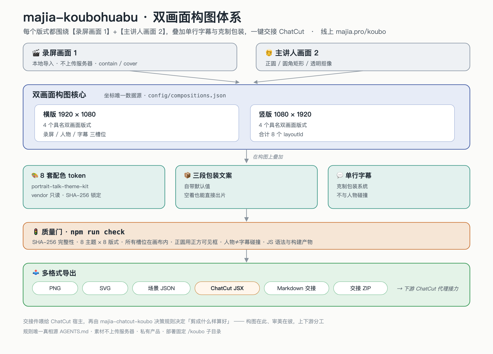

# majia-koubohuabu

「口播画布」是一个双素材口播视频构图工具：每一个版式都围绕【录屏画面 1】+ 【主讲人画面 2】，再叠加单行字幕和克制的包装系统。

线上版：[https://www.majia.pro/koubo](https://www.majia.pro/koubo)



> 矢量源 [`docs/framework.svg`](docs/framework.svg)。构图在此、审美在彼：本工具负责双画面构图与交接件，下游由 `majia-chatcut-koubo` 决策规则决定「剪成什么样算好」。

## 当前能力

- 本地导入录屏和主讲人图片 / 视频，素材不上传服务器。
- 横版 `1920×1080` 与竖版 `1080×1920` 两套原生画布。
- 每种画幅 4 个具名双画面版式，共 8 个 `layoutId`。
- 录屏支持 `contain` / `cover`；人物支持正圆、圆角矩形和透明抠像。
- 使用原始 `portrait-talk-theme-kit` 的 8 套配色 token，原包通过 SHA-256 锁定。
- 三段包装文案自带默认值并收入「微调」折叠区，不填写文字也能直接出片。
- 导出 PNG、SVG、场景 JSON、ChatCut JSX、Markdown 交接文档，或一键打包为交接 ZIP。

## 本地开发

需要 Node.js 20 或更高版本，无第三方运行时依赖。

```bash
npm run check
npm run dev
```

打开 [http://127.0.0.1:4173/koubo/](http://127.0.0.1:4173/koubo/)。

## 仓库结构

```text
majia-koubohuabu/
├── AGENTS.md                         # 所有 AI 工具的主规则
├── CLAUDE.md / GEMINI.md             # 不同 AI CLI 入口
├── src/                              # 在线工具源码
├── config/compositions.json          # 横竖版双画面坐标的唯一数据源
├── vendor/portrait-talk-theme-kit/   # 原始配色包，只读
├── vendor/manifest.sha256.json       # 原包完整性锁
├── docs/                             # 产品、架构、ChatCut 和部署说明
├── scripts/                          # 零依赖构建、校验、本地服务
├── deploy/                           # 独立 ECS 发布脚本
└── dist/                             # 生成物，不提交
```

## 数据源边界

| 需求 | 修改位置 |
| --- | --- |
| 新增 / 调整横竖版构图 | `config/compositions.json` |
| 修改交互与导出 | `src/dual-studio.js` |
| 修改页面视觉 | `src/index.html` + `src/dual-studio.css` |
| 修改 ChatCut 交接规则 | `docs/chatcut-integration.md` 和 JS 导出器 |
| 调整配色 | 先建新版 token；不覆写 `vendor/` |

## 质量门槛

`npm run check` 会验证：

- 原始 ZIP 及关键 token 的 SHA-256。
- 8 套原始主题与 8 个双画面版式。
- 所有槽位都在当前画布内。
- 正圆人像使用正方形可见框。
- 人物不与单行字幕碰撞。
- JavaScript 语法、构建输出与运行时资源完整性。

## AI 工具接力

无论使用 Codex、Claude Code、Gemini CLI、Cursor 或 GitHub Copilot，先读取 [AGENTS.md](AGENTS.md)，再按任务读取 `docs/`。仓库已为各工具提供轻量入口，但规则的唯一真相源仍是 `AGENTS.md`。

## 部署

线上目录固定为 `/var/www/personal-site/koubo`，发布脚本只替换该子目录，不得覆盖个人站根目录或其他子域名。详见 [docs/deployment.md](docs/deployment.md)。

## 许可

本仓库为私有项目，未授权对外复制或再分发。
